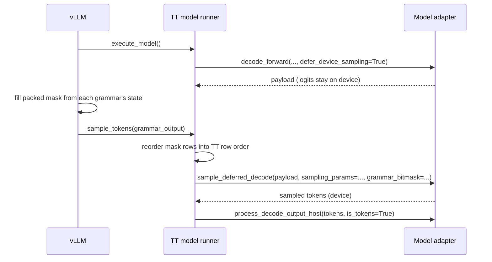

# Device grammar sampling: what a model adapter must implement

> This page specifies what a model adapter must implement for device grammar
> sampling. The operator view is in the README section
> [Structured Output Sampling](../README.md#structured-output-sampling),
> capability keys are in the [capability reference](MODEL_CAPABILITIES.md),
> and decode input commands are in the
> [decode reload contract](DECODE_RELOAD_CONTRACT.md).

**TL;DR.** Structured outputs (JSON, regex, fixed choices) used to send each
decode step's full logits to the CPU, where vLLM filtered out disallowed tokens
and picked the next one. Now only the small allowed-token filter goes to the
chip, and the chip picks the token. Decode is expected to be faster in every case,
greedy and random sampling alike, although time to first token can be slightly
higher. The gain is largest with random
sampling (temperature, top-k, top-p), many concurrent requests and smaller
models, where CPU sampling used to dominate each step. It is smaller with
greedy decoding, few concurrent requests, or larger models and long contexts,
where the model's own compute dominates. Models on the shared tt_transformers
code opt in with one flag; others implement a small "run the forward now,
sample later" interface. It is opt-in and decode-only. Ineligible steps fall
back to the CPU path before forward submission; unsupported launch combinations
may instead be rejected, and failures after deferred submission are terminal.

## Status

| Side | State |
| --- | --- |
| Plugin | Merged in tenstorrent/vllm-tt-plugin#123. |
| tt-metal reference implementation | Merged in tenstorrent/tt-metal#55892: tt_transformers `LlamaForCausalLM`, `QwenForCausalLM`, `MistralForCausalLM`. |
| Scope | Decode only, one sampler per data-parallel replica, no logprobs, synchronous scheduling. |
| Follow-up work | tenstorrent/tt-metal#60370. |

Without this contract, structured-output requests keep vLLM's host sampling
path: the adapter returns full logits and vLLM applies the grammar on the CPU.
With it, the logits stay on device, the grammar mask is uploaded, and the
adapter's device sampler picks the token.

## Why sampling is deferred

vLLM computes the grammar mask at sample time, after `execute_model()` has
submitted the forward. The decode step is therefore split into two calls:



Between the two calls the adapter holds exactly one pending payload. The
plugin never submits another decode before consuming it.

## When the plugin uses the contract

The startup gates and per-step routing are in the README section
[Structured Output Sampling](../README.md#structured-output-sampling), the
[capability reference](MODEL_CAPABILITIES.md#sampling-and-async-capabilities)
and [scheduling](SCHEDULING.md#when-steady-async-decode-is-allowed). In
short: decode steps only, synchronous scheduling, and one ineligible request
moves the whole step to host sampling. Random-sampling requests without
`top_k` stay on device only with a server
[default top-k](../README.md#default-top-k-for-device-sampling).

## 1. Capability declaration

```python
class MyModelForCausalLM(Generator):
    decode_input_update_contract = 1
    model_capabilities = {
        "supports_sample_on_device": True,
        "supports_device_grammar": True,
        "max_device_top_k": 32,  # exact stochastic top-k bound of the device sampler
        ...
    }
```

| Key | Rule |
| --- | --- |
| `supports_device_grammar` | Must be a `bool`. The platform rejects any other type at startup. |
| `supports_sample_on_device` | Must be `True` when `supports_device_grammar` is `True`. |
| Block-output models (`output_tokens_per_step > 1`) | Must not declare `supports_device_grammar`. |
| `max_device_top_k` | Strongly recommended. Without it, a larger `top_k` is not routed to host and the sampler's own clamp applies. |
| `supports_device_penalties` | Defaults to `True`. Declare `False` if the device sampler cannot apply penalties. |

Declare `model_capabilities` on the class and the instance: platform admission
reads the class, and runtime sampling reads the instance (see
[ownership and resolution](MODEL_CAPABILITIES.md#ownership-and-resolution)).

The declaration is a static promise. Runtime support is reported separately
by `device_grammar_enabled` (section 2), so a mesh layout the sampler cannot
serve falls back to host grammar instead of failing.

## 2. Methods the plugin calls

The diagram above shows the call order. The requirements are:

| Member | Requirement |
| --- | --- |
| `enable_device_grammar()` | Called once after load. Allocate the persistent mask buffers on every replica before any trace capture. If the loaded layout is unsupported, leave the feature disabled instead of raising. |
| `device_grammar_enabled` | `True` only when every replica can apply a mask. `False` makes the plugin log a warning and keep host grammar. |
| `warmup_model_decode(..., can_sample_device_grammar=True)` | Compile, and capture when tracing, the grammar-on sampling variant of every warmed sampling configuration except logprobs. |
| `decode_forward(..., defer_device_sampling=True)` | See section 2a. |
| `sample_deferred_decode(payload, sampling_params=..., grammar_bitmask=...)` | See section 2b. |
| `process_decode_output_host(tokens, is_tokens=True)` | Accept the device output of `sample_deferred_decode`, as for ordinary device sampling. |

### 2a. `decode_forward(..., defer_device_sampling=True)`

The plugin sends the usual decode arguments with these differences:

- `defer_device_sampling=True`;
- no `sampling_params`;
- `read_from_device=False`;
- the reload commands from the
  [decode reload contract](DECODE_RELOAD_CONTRACT.md).

The adapter must:

1. **Run the forward with device-sampling layout.** Use `on_device_logits=True`
   and the device-sampling trace variant.
2. **Not sample, and not change sampler state.** Leave seeds, penalty history
   and the slot remap untouched.
3. **Return one opaque payload.** It owns the device logits and everything
   sampling will need later: positions, `prompt_tokens`, `output_tokens`,
   `slot_remap`, the trace flags and the reload commands.
4. **Allow only one pending payload.** Another `decode_forward` before the
   payload is consumed must raise.

The plugin treats the payload as opaque and only hands it back.

### 2b. `sample_deferred_decode(payload, sampling_params, *, grammar_bitmask)`

The adapter must:

1. **Consume the payload exactly once.** A stale or already-consumed payload
   raises and leaves the pending one intact.
2. **Validate before changing any state.** Check the mask (section 3) and
   reject logprobs and row-sharded sampling before the slot remap, seeds or
   penalty history change.
3. **Apply the captured commands, not new ones.** Use the payload's reload
   commands, positions and `slot_remap` exactly as an immediate device-sampled
   `decode_forward` would. `sampling_params` and `grammar_bitmask` are the only
   new inputs.
4. **Return the immediate path's output.** That is what
   `decode_forward(..., sampling_params=..., read_from_device=False)` returns:
   device tokens per replica.
5. **Fail permanently on error.** Any exception means the decode was submitted
   but sampler state may be partly advanced. Mark the adapter failed and make
   every later `decode_forward` and sampling call raise. The plugin also
   disables the runner, and nothing retries on host.

`sample_decode_on_device(...)` must reject a deferred payload, so the two
entry points cannot be mixed.

## 3. The grammar mask

| Property | Requirement |
| --- | --- |
| Type | `torch.int32` on host, rank 2. |
| Shape | `[rows, ceil(vocab_size / 32)]`, where `vocab_size` is vLLM's `model_config.get_vocab_size()`. It must equal the sampler's vocabulary size. |
| Bits | Word `w`, bit `j` (LSB first) allows token `32 * w + j`. This is vLLM's and xgrammar's packing. Bits at or above `vocab_size` are ignored. |
| Rows | Row `r` is decode row `r`, in the same order as `sampling_params` and the post-remap device rows. Rows without a structured request are `-1` (all allowed). |
| Row count | One sampler: at most `max_batch_size` rows; the adapter pads the rest as all-allowed. Several replicas in one adapter (`data_parallel > 1`): the sum of the replicas' `max_batch_size`, split in replica order. |
| Empty rows | A row that allows no token is invalid and must raise during validation. |
| Lifetime | Each call replaces the whole mask. Nothing carries over between steps. |

Apply the mask after penalties and before temperature, top-k, top-p and
argmax. Disallowed logits become `-inf`. Padded vocabulary entries beyond
`vocab_size` must stay excluded.

## 4. Traces and warmup

- **Separate trace variant:** grammar-on sampling is its own variant. The
  reference implementation keys sampling traces by grammar on/off, beside
  penalties, logprobs and force-argmax.
- **Allocate first:** mask buffers must exist before any trace is captured,
  because a buffer allocated while a trace is live can be overwritten when that
  trace replays. The reference `enable_device_grammar()` raises if any model
  trace was captured first.
- **Warmup is required when tracing:** a trace can only record programs that
  are already compiled; an uncompiled one fails capture with
  `TT_FATAL: !is_capturing_trace`. Warmup compiles every grammar variant first
  and captures second. Without warmup, the plugin keeps host grammar. With
  `trace_mode: none` nothing is captured and warmup is not required.
- **Trace memory:** grammar variants enlarge the sampling trace footprint, so
  check `trace_region_size` for large models.
- **Wrapped samplers:** an adapter that wraps or patches `sampling.sample` must
  forward the `grammar_bitmask` keyword, as the reference PR does for Gemma4.

## 5. Not covered by this contract

The plugin keeps host sampling for these; an adapter need not handle them on
device:

- structured prefill;
- logprobs, including `logprobs=0`;
- row-sharded sampling (`sampling_dp > 1`);
- upstream async scheduling;
- speculative decoding, which rejects structured requests at admission;
- block-output models;
- host-only options (`min_p`, `logit_bias`, `bad_words`, `allowed_token_ids`,
  `min_tokens`, custom logits processors).

## 6. Reusing the tt_transformers implementation

An adapter built on `models/tt_transformers/tt/generator.py` `Generator` and the
shared `models/common/sampling` sampler already implements sections 2–4. To
opt in, check that:

1. every replica exposes `model.sampling` as a `SamplingGenerator`;
2. `sampling_dp == 1`;
3. the padded vocabulary splits into vocab shards of whole 32-token words;
4. the adapter declares the capability, as in section 1.

| Piece | Location (tt-metal#55892) |
| --- | --- |
| Payload, `enable_device_grammar`, `decode_forward` deferred branch, `sample_deferred_decode`, failure latch | `models/tt_transformers/tt/generator.py` |
| Grammar trace key, mask validation, `grammar_bitmask` on `sample`/`capture_trace`/`precompile` | `models/common/sampling/generator.py` |
| `format_grammar_bitmask`, persistent buffers, on-device unpack and `-inf` mask | `models/common/sampling/tt_sampling.py` |
| Grammar-on warmup sweep | `models/common/warmup/warmup_utils.py` |
| Capability description | `models/common/model_capabilities.py` |

An adapter with its own generator implements section 2 directly. It can still
reuse `TTSampling.enable_device_grammar`, `update_grammar_bitmask` and
`format_grammar_bitmask` for the mask itself.

## 7. Validation checklist

Host tests, mirroring the reference PR:

- **Mask formatting:** `format_grammar_bitmask` packing, tail bits, padding
  and empty-row rejection (`models/common/tests/test_tt_sampling.py`).
- **Deferred payload:** consumed exactly once, stale payloads rejected,
  failure latch, validation before any state change
  (`models/common/tests/test_sampling.py`).
- **Decode commands:** the deferred path keeps the reload commands
  (`models/common/tests/test_decode_update_contract.py`).

On device, through the plugin:

1. Start the server with `--no-async-scheduling` and
   `sample_on_device_mode: decode_only`, and set `VLLM_LOGGING_LEVEL=DEBUG`.
2. Run `tests/tt/test_structured_output_dp1.py`. The server log must contain
   `TT device grammar sampling active` lines; zero means the path silently
   fell back to host.
3. Run vLLM's `benchmarks/benchmark_serving_structured_output.py`. Expect
   `correct_rate == 100%`.
4. Compare decode step time with the same run without
   `sample_on_device_mode`, which is the host-grammar fallback.
